# ScamShield AZ

**Behavioral risk intelligence and cost-aware intervention for Authorized Push Payment (APP) scams.**

In an APP scam, the customer authorizes the transfer themselves because a scammer is manipulating them (a fake "bank security" call, an investment or romance scam, a fake seller). Transaction-based fraud models struggle with these. The payment looks like the customer's own, and the customer is genuinely logged in.

ScamShield AZ adds two layers on top of an existing fraud score:

1. **Payment-journey behavioral intelligence.** A CatBoost model combines the existing fraud score with how the customer moved through the app during the payment: hesitation, app switching, edits, active calls, pasted beneficiaries. It outputs calibrated scam probabilities.
2. **Cost-aware intervention.** A transparent decision engine chooses **Allow / Warn / Verify / Temporary Hold** by minimizing expected cost. The cost includes the scam loss, operational cost and the friction caused to genuine customers.

> ⚠️ **Scientific integrity.** This MVP uses **synthetic data** and **assumed costs**. The results show that the method works end to end and how it behaves under the stated assumptions. They are **not** evidence of real-world banking performance.

---

## Quick start

```bash
# 1. Install (Python 3.11+)
python -m venv .venv && source .venv/bin/activate      # Windows: .venv\Scripts\activate
pip install -e ".[dev]"

# 2. Generate data, train, calibrate, evaluate, and run the sensitivity analysis (~40 s)
python scripts/run_pipeline.py                 # add --skip-sensitivity for a ~15 s run
python scripts/run_pipeline.py --figures-only  # redraw figures from saved results

# 3. Run the tests (~40 s)
pytest

# 4. Terminal 1: API + customer banking app
uvicorn app.api.main:app                       # app:  http://127.0.0.1:8000/app
                                               # docs: http://127.0.0.1:8000/docs

# 5. Terminal 2: analyst dashboard
streamlit run app/dashboard.py                 # http://localhost:8501
```

The customer app ships pre-built in `web/dist`, so **Node.js is not needed** to run the demo: FastAPI serves it at `/app`, on the same origin as the API.

To develop the customer app (Node 20+), with the API still running in terminal 1:

```bash
cd web
npm install
npm run dev        # http://localhost:5173/app/ with hot reload; API calls are proxied to :8000
npm run build      # type-check, then rebuild web/dist for FastAPI to serve
```

### Live demo script (about 5 minutes)

1. **Customer app** (`/app`): choose *Safe-account impersonation scam*, then Transfer → New recipient → Continue → Continue → **slide to send** → any 4-digit PIN. The payment is put on **hold**.
2. Choose *Online marketplace purchase* and repeat. The customer sees a **warning** and must confirm they trust the recipient before "Send anyway" unlocks.
3. Choose *'Hi Mum' family emergency scam*. A **security check** appears; answer "Yes" to "keep this secret" and the payment is stopped.
4. Choose *Routine rent payment* and pick the saved recipient. The payment is **allowed**.
5. Switch to the **analyst dashboard**, pick the same scenario, and show why: scores, SHAP factors, the expected-cost table and the decision map.

To score your own interaction in the customer app, switch "In-app behaviour" to **Live session**. Pasting the IBAN, editing the amount, going back or switching to another window then changes the decision.

The dashboard runs the shared assessment service in-process by default. In the sidebar you can switch it to call the FastAPI service instead. The customer app always calls the API. Both paths run the same `service.py`, so a given input gets the same scores and action everywhere.

Example API call:

```bash
curl -X POST http://127.0.0.1:8000/assess -H "Content-Type: application/json" -d '{
  "transaction": {"amount": 3500, "hour": 11, "is_new_beneficiary": true, "prior_txn_count": 30,
                  "prior_avg_amount": 240, "prior_max_amount": 1100, "txn_last_24h": 0, "txn_last_7d": 0,
                  "amount_last_24h": 0, "hours_since_last_txn": 150, "n_distinct_beneficiaries": 6, "tenure_days": 3100},
  "journey_events": [
    {"event_type": "login", "t_offset_s": 0}, {"event_type": "call_active", "t_offset_s": 0.5},
    {"event_type": "payments_menu", "t_offset_s": 6}, {"event_type": "payee_new_form", "t_offset_s": 9},
    {"event_type": "app_background", "t_offset_s": 12}, {"event_type": "app_foreground", "t_offset_s": 71},
    {"event_type": "payee_pasted", "t_offset_s": 78}, {"event_type": "amount_entered", "t_offset_s": 88},
    {"event_type": "amount_edit", "t_offset_s": 97}, {"event_type": "review_screen", "t_offset_s": 174},
    {"event_type": "confirm", "t_offset_s": 205}]
}'
```

`/assess` accepts **either** raw `journey_events` (preferred) **or** pre-computed `journey_features`, never both. It returns the baseline and enhanced risk, the recommended action, the action the baseline policy would take, a per-action cost breakdown with eligibility, SHAP risk factors and baseline drivers. `/health` reports whether the models are loaded and the baseline thresholds. `/scenarios` returns the demo scenarios' **inputs only**: outcomes always come from `/assess`. If the artifacts are missing, the API stays up: `/health` reports `degraded` and `/assess` returns 503.

---

## Architecture

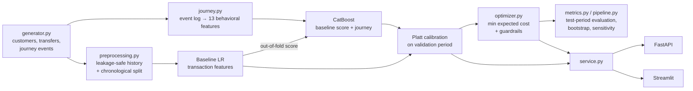

```text
scamshield-az/
├── app/
│   ├── api/{main.py, schemas.py}      FastAPI: /assess, /health, /scenarios; serves web/dist at /app
│   ├── dashboard.py                   Streamlit analyst dashboard (4 tabs)
│   ├── ui_kit.py                      dashboard design system: CSS, tables, KPI strips, tags
│   ├── charts.py                      interactive Altair charts (bundled with Streamlit)
│   ├── customer_view.py               compact customer flow embedded in the dashboard
│   └── static/                        bundled Inter font (OFL)
├── web/                               customer banking app (React + TypeScript + Vite)
│   ├── src/App.tsx                    screen state machine, API calls, live journey capture
│   ├── src/screens/                   Home, Payment (recipient/amount/review/PIN), Interventions, Result
│   ├── src/DemoPanel.tsx              presenter controls (outside the phone)
│   ├── src/journey.ts                 records in-app events in the ML feature vocabulary
│   ├── src/styles.css                 design tokens and components
│   └── dist/                          pre-built app served by FastAPI
├── src/scamshield/
│   ├── config.py                      paths + YAML loading
│   ├── data/generator.py              synthetic customers, transfers, journeys, labels
│   ├── data/preprocessing.py          customer context (prior-only), model features, split
│   ├── features/journey.py            event vocabulary + journey feature extraction
│   ├── models/train.py                LR, CatBoost, OOF stacking, Platt calibration
│   ├── models/inference.py            artifact loading, scoring, SHAP explanations
│   ├── decision/optimizer.py          expected-cost engine, guardrails, fixed-threshold baseline
│   ├── evaluation/metrics.py          PR-AUC, ECE, equal-FPR, policy outcomes, bootstrap
│   ├── evaluation/plots.py            static evaluation figures (README)
│   ├── pipeline.py                    end-to-end experiment + sensitivity orchestration
│   └── service.py                     scoring + decision for one transfer (shared by API, dashboard, app)
├── scripts/run_pipeline.py            CLI entry point
├── configs/{model,intervention,scenarios}.yaml
├── tests/                             66 tests: features, models, optimizer, API, scenarios, dashboard
├── artifacts/{models,figures}/, metrics.json, predictions_test.parquet
└── data/{raw,processed}/              generated parquet files (git-ignored)
```

Changes to the suggested layout, and why:

- `pipeline.py` keeps orchestration reusable and testable, so the script stays a thin CLI.
- `service.py` gives the API and the dashboard exactly the same scoring and decision code.
- `plots.py` keeps figure code separate from the metric math.
- `scenarios.yaml` holds the demo inputs as data rather than code.
- `.streamlit/config.toml` sets the dashboard theme.

---

## Methodology

### 1. Synthetic data (`generator.py`)

| Item | Value |
|---|---|
| Customers | 2,500 with latent traits: age, digital literacy, income, spending scale, activity rate, interaction tempo, habits (pasting IBANs, switching apps, being on calls) |
| Period | Oct 2024 – Dec 2025. The first 3 months are **history-only warm-up** and are never modeled. |
| Modeled transfers | **30,483**, of which **684 scams (2.2%)** |
| Journey events | ~375k in-app events (17 event types) |

The labels come from a generative story rather than a scoring rule:

1. Scam **episodes** arrive with a hazard that depends on vulnerability (age and low digital literacy, plus noise) and on seasonal campaign intensity.
2. Each episode has a **type** that sets the number of payments, their timing, amounts and beneficiary pattern:
   - **Impersonation:** 1–3 large transfers within hours.
   - **Investment:** escalating payments over weeks, often to the *same* beneficiary.
   - **Purchase:** small amounts, little coaching, hard to detect.
   - **Romance:** repeated evening payments.
3. A latent **coaching intensity** (how strongly a scammer is directing the victim in real time) shifts the journey. Call probability, pasted IBANs, app switches, time outside the app, edits, back-navigation and confirmation time all rise with it. Browsing falls.

The signal is overlapping by design:

- Slow, elderly or low-literacy customers hesitate legitimately.
- Many legitimate customers paste IBANs from messengers or happen to be on a call.
- About 4% of legitimate transfers are large one-off purchases to new beneficiaries.
- Repeat scam payments go to *known* beneficiaries.
- Coaching is latent and never stored. No observed feature determines the label.

`journey_signal_strength` (0–1) scales the behavioral signal for the sensitivity analysis. It changes **only** the journeys: the transactions are identical across strengths. A test checks this.

### 2. Features and leakage control (`preprocessing.py`, `journey.py`)

- **Customer context** (count, mean and max of previous amounts, 24h and 7d velocity, time since last transfer, new beneficiary, distinct beneficiaries, tenure) is computed **only from strictly earlier transfers**. Rolling windows use `closed="left"`.
- A test checks that changing a *future* transfer leaves every earlier feature unchanged.
- **Labels of earlier transfers are never used.** Scam reports arrive late in reality, so using them would leak future information.
- **Age and other demographics are not model features.** They drive the simulation but are excluded on fairness grounds.
- **Journey features** come from one function, `extract_journey_features(events)`. The training pipeline, API and dashboard all call it, so the definitions cannot drift.
- The **split is chronological**:

  | Period | Dates | Transfers | Scams | Used for |
  |---|---|---|---|---|
  | Train | Jan–Jul 2025 | 17,679 | 425 | Model fitting |
  | Validation | Aug–Sep 2025 | 5,205 | 126 | Calibration and baseline threshold tuning |
  | Test | Oct–Dec 2025 | 7,599 | 133 | Final evaluation only |

### 3. Models (`train.py`)

- **Baseline (the simulated "existing system").** Standardized logistic regression on 13 transaction features.
- **ScamShield.** CatBoost (depth 4, 600 trees) on the *baseline score* plus 13 journey features. On training rows the baseline score is **out-of-fold** (5-fold), so the stacker never sees a score from a model fitted on that same row. Validation and test rows get the score from the full-train baseline.
- **Calibration.** Both models get **Platt scaling, fitted on the validation period**. Isotonic regression was rejected because the validation period has about 120 positives, and isotonic overfits at that size.
- **Ablation.** Three extra CatBoost variants: transaction-only, journey-only, and all raw features.

### 4. Cost-aware decision engine (`optimizer.py`)

$$EC(a) = p\,L\,(1-e_a) + C_a + (1-p)\,F_a$$

The engine takes the permitted action with the lowest EC. Ties go to the least intrusive action.

Default assumptions (in AZN, from `configs/intervention.yaml`, **illustrative only**):

| Action | Effectiveness e | Operational C | Friction F |
|---|---|---|---|
| Allow | 0 | 0 | 0 |
| Warn | 0.15 | 0.05 | 1 |
| Verify | 0.45 | 2 | 6 |
| Hold | 0.85 | 20 | 60 |

### Decision Policy Preview

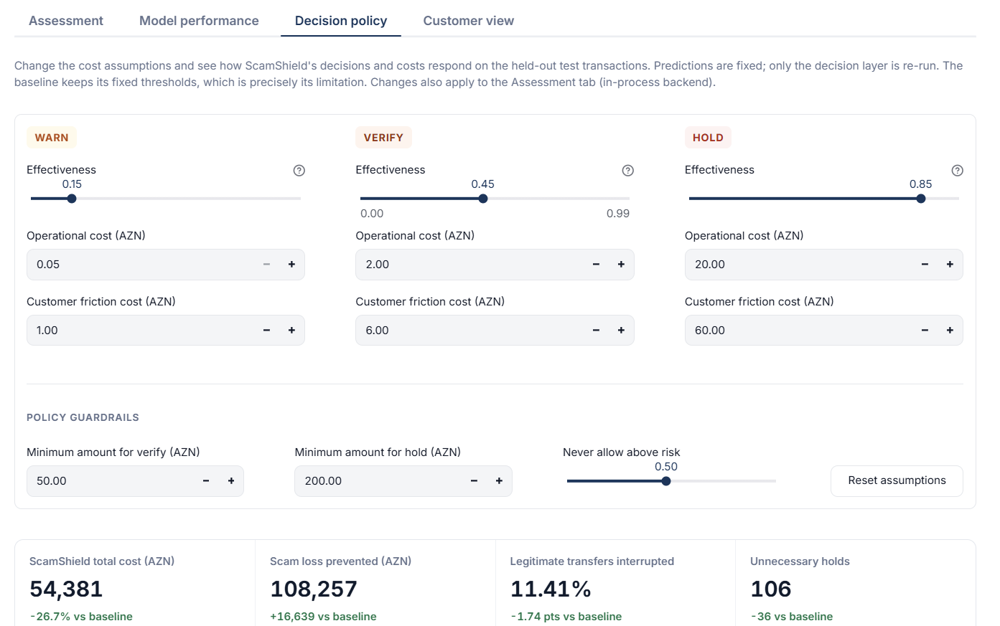

The same guardrails apply to **both** policies:

- No verification below 50 AZN.
- No hold below 200 AZN, or when the caller sets `hold_allowed=false`.
- Never allow when p ≥ 0.5.
- Any action that is not permitted is downgraded to the strongest permitted action below it.

**The baseline policy is not a straw man.** Its fixed warn/verify/hold thresholds are **grid-searched on the validation period to minimize the same total cost**. That is the best a fixed-threshold policy can do on this data: warn 0.03, verify 0.05, hold 0.15.

Realized costs on labeled data:

- **Scams:** residual loss L(1−e) and prevented loss L·e, in expectation over whether the intervention succeeds. This keeps the evaluation deterministic.
- **Legitimate transfers:** friction F.
- **All transfers:** operational cost C.

---

## Results (held-out test period, Oct–Dec 2025: 7,599 transfers, 133 scams)

All numbers come from `artifacts/metrics.json`, produced by `python scripts/run_pipeline.py` (seed 42, fully reproducible).

### Model quality

| Model | PR-AUC | ROC-AUC | Brier | ECE | Recall @1% FPR | Recall @5% FPR |
|---|---|---|---|---|---|---|
| Baseline LR (transaction) | 0.183 | 0.891 | 0.0157 | 0.0032 | 21.8% | 47.4% |
| CatBoost, transaction only | 0.285 | 0.897 | 0.0145 | 0.0030 | 26.3% | 51.1% |
| CatBoost, journey only | 0.488 | 0.878 | 0.0115 | 0.0046 | 43.6% | 66.2% |
| **ScamShield (baseline score + journey)** | **0.544** | **0.942** | **0.0110** | **0.0015** | **54.1%** | **72.2%** |
| CatBoost, all raw features | 0.600 | 0.952 | 0.0100 | 0.0019 | 57.9% | 75.2% |

At an **equal 1% false-positive rate**, ScamShield catches 54% of scams against 22% for the baseline, with precision of 49% against 28%. The paired, label-stratified bootstrap 95% CI for the PR-AUC gain is **[+0.28, +0.42]**.

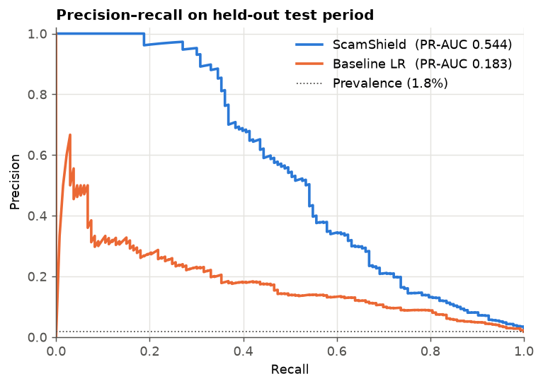
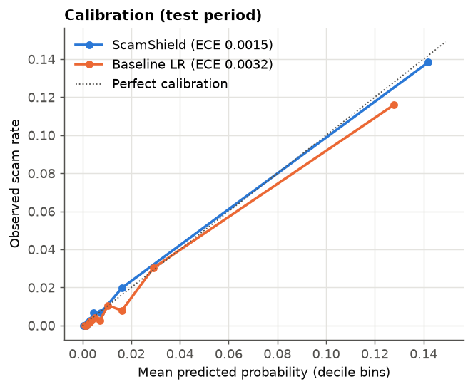
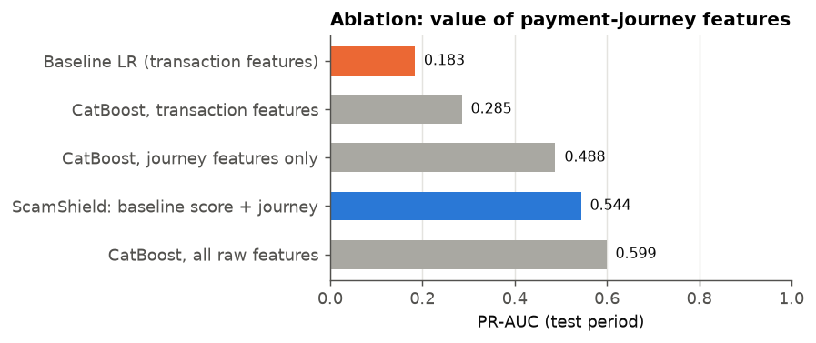

### End-to-end: baseline vs. ScamShield (same transactions, same cost assumptions)

| | Baseline: score + fixed thresholds | **ScamShield: journey ML + cost-aware** |
|---|---|---|
| Scam recall (any intervention) | 73.7% | **82.7%** |
| Legit transfers interrupted (policy FPR) | 13.2% | **11.4%** |
| Warn / Verify / Hold | 457 / 439 / 184 | 445 / 348 / 169 |
| Unnecessary holds (hold on legit) | 142 | **106** |
| Prevented scam loss | 91,618 AZN (61.1%) | **108,257 AZN (72.2%)** |
| Residual scam loss | 58,236 | **41,597** |
| Operational + friction cost | 15,936 | **12,784** |
| **Total cost** | 74,172 | **54,381 (−26.7%)** |

### Decision Map

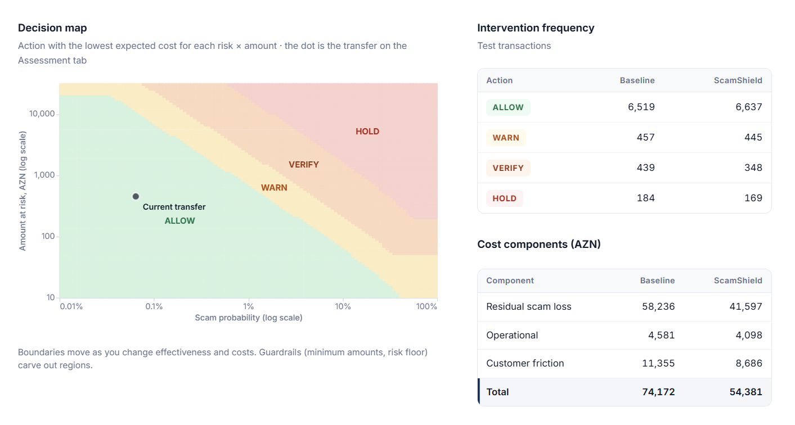

The bootstrap 95% CI for the cost reduction is **[9,948, 31,029] AZN**. The interval is wide because only 133 scams fall in the test period.

**Where the gain comes from** (supplementary 2×2 attribution, total cost in AZN):

| Score \ Policy | Fixed thresholds | Cost-aware optimizer |
|---|---|---|
| Baseline score | 74,172 | 66,595 |
| ScamShield score | 58,080 | **54,381** |

The better model is responsible for most of the reduction. Amount-aware decisions add a further, independent gain.

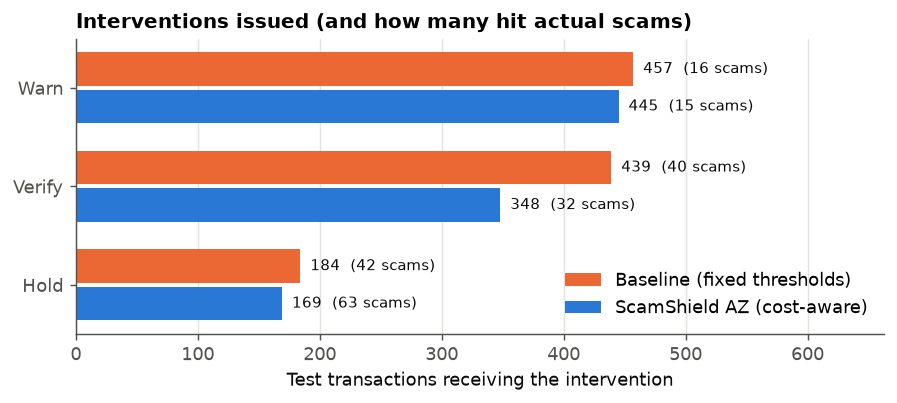
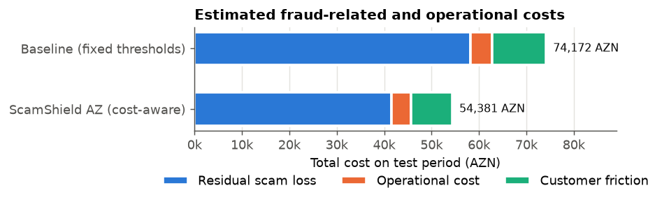

### Sensitivity analysis

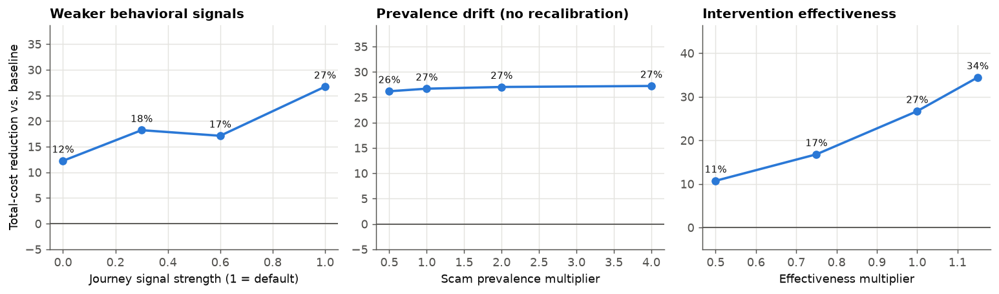

| Scenario | ScamShield PR-AUC | Cost reduction vs. baseline |
|---|---|---|
| Journey signal 1.0 (default) | 0.544 | 26.7% |
| Journey signal 0.6 | 0.400 | 17.0% |
| Journey signal 0.3 | 0.250 | 18.2% |
| Journey signal 0.0 (no behavioral signal) | 0.183 (= baseline) | 12.2% (optimizer only) |
| Scam prevalence ×0.5 / ×2 / ×4 (no recalibration) | 0.469 / 0.626 / 0.710 | 26.2% / 27.0% / 27.2% |
| Intervention effectiveness ×0.5 / ×0.75 / ×1.15 | n/a | 10.7% / 16.8% / 34.4% |

How to read the three blocks:

- **Weaker signals.** The data is regenerated and both models are retrained. With no behavioral signal, the journey model collapses to the baseline, as it should. The remaining 12% comes from the cost-aware policy alone. Results at 0.6 and 0.3 are within noise of each other.
- **Prevalence.** Test scams are re-weighted to simulate drift after deployment. The relative saving is stable, but absolute calibration would degrade. In production, monitor and recalibrate.
- **Effectiveness.** The baseline thresholds are re-tuned for each assumption. The benefit depends strongly on how well interventions actually work, so the effectiveness values are the most important numbers to validate with real A/B tests.

---

## Interfaces

### Customer banking app (`web/`)

#### Customer transaction walkthrough


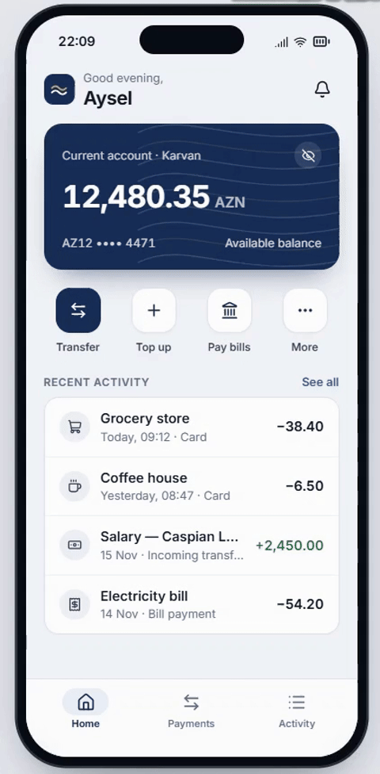


This is a simulated mobile banking app for *Karvan*, a fictional bank: the bank, people and IBANs are invented, and no real payment is made. On desktop it renders inside a phone frame next to a scenario panel. On a phone it runs full-screen, and the panel opens from a "Scenarios" button.

- **Home:** balance, quick actions and recent activity. Payments you make in the demo appear in Activity with their status (Completed, On hold, Cancelled, Stopped).
- **Payment journey:** recipient (saved, or a new IBAN with bank detection) → amount and purpose → review → PIN pad → "Checking your payment" → ScamShield's decision from `POST /assess`.
- **Allow:** receipt.
- **Warn:** guidance chosen from what the payment shows (online purchase, details copied from a chat, new recipient, active call). "Send anyway" only unlocks after the customer confirms they trust the recipient.
- **Verify:** three questions, then a one-time code delivered as a simulated SMS. Risky answers stop the payment. If someone asked the customer to pay, they must confirm they called that person back.
- **Hold:** the payment is paused, with a review timeline and safety guidance.
- **Customer-facing text:** plain banking language, with no scores or model details shown to the customer. The presenter panel (outside the phone) shows the decision, both scores and the cost explanation.
- **Interaction and motion:** directional page transitions, slide-to-send (drag, or Enter on the keyboard), an animated security check while the payment is assessed, a drawn checkmark and receipt on success, SMS-style one-time codes you can tap to fill, a shaking code field on a wrong code, a review timeline on hold, and a balance that counts up. Motion is short and purposeful, and is disabled when the operating system's "reduce motion" setting is on.
- **Stack:** React 19, TypeScript and Vite, plus `lucide-react` icons and the bundled Inter font. Plain CSS with design tokens; no UI framework.

### Analyst dashboard (`app/dashboard.py`)

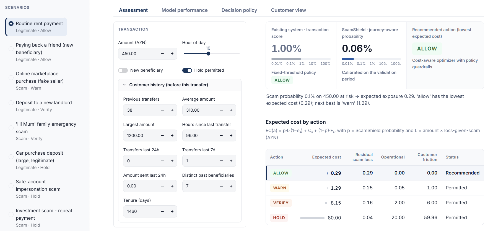

A decision-support layout with one visual system (Inter, a restrained navy/gray palette, status colours used only for actions). KPIs sit in single divided strips rather than separate cards, tables are custom with the key row highlighted, and charts are interactive Altair figures read directly from the saved artifacts. The static PNGs in `artifacts/figures/` are still produced by the pipeline for this README.

| Tab | Contents |
|---|---|
| **Assessment** | 8 predefined scenarios (4 legitimate, 4 scams) covering all four actions. Editable transaction, customer history and journey inputs: either an editable event log or behavioral sliders. Shows both risk scores, both policies' actions, the per-action expected-cost table, SHAP risk factors and baseline drivers. |
| **Model performance** | KPI strip with deltas vs. baseline, a metric-by-metric end-to-end comparison, bootstrap CIs, interactive charts (precision–recall, calibration, interventions, costs, ablation, importance, sensitivity) with hover details, the score × policy attribution, and the full classification table. |
| **Decision policy** | Edit effectiveness, costs and guardrails to re-run the decision layer live on the test transactions. Includes a **decision map** (action regions over risk × amount) with the current transfer plotted. Changes also apply to the assessment tab. |
| **Customer view** | A compact, embedded version of the customer app above: a simulated mobile-banking app (fictional bank and accounts) showing what the customer experiences: transfer details → review and PIN → ScamShield's live decision → final status. **Allow**: money sent. **Warn**: plain-language scam warning; the customer must tick "I trust this recipient" to continue. **Verify**: three security questions plus a one-time SMS code; answers such as "move money to a safe account" stop the payment. **Hold**: payment paused with a review timeline. No scores or model details are shown to the customer. |

Nothing is hardcoded. Every score comes from the trained models, and every action comes from the optimizer.

Scenarios and the action each is designed to show (a test checks the trained models really produce it):

| Scenario | Type | Action |
|---|---|---|
| Routine rent payment | legitimate | Allow |
| Paying back a friend (new beneficiary) | legitimate | Allow |
| Online marketplace purchase (fake seller) | scam | Warn |
| Deposit to a new landlord | legitimate | Verify |
| 'Hi Mum' family emergency scam | scam | Verify |
| Car purchase deposit (large, legitimate) | legitimate | Hold |
| Safe-account impersonation scam | scam | Hold |
| Investment scam - repeat payment | scam | Hold |

If you change the cost assumptions or retrain with different settings, some scenarios may land on a different action. That is the decision engine working as designed, and the scenario test will tell you which ones moved.

Talking points:

- **Investment scam, repeat payment.** The baseline says 3.5%, because the beneficiary is known and the amount is moderate, so it only warns. ScamShield says 66% from the app switching, hesitation and back-navigation, and puts a hold on the payment.
- **Car deposit.** The baseline says 43% (large amount to a new beneficiary). ScamShield lowers this to 5% because the journey is calm. With 6,000 AZN at stake, 5% still justifies a hold: the cost math in action. Lower the amount in the UI to see the action change.

---

## Limitations and honest caveats

- **Synthetic data.** The generator encodes my assumptions about scam behavior. The models partly learn those assumptions back. Real journeys are noisier, scammers adapt, and telemetry is incomplete (call detection is OS- and consent-dependent).
- **Assumed costs.** Effectiveness and friction values are illustrative. Friction in particular (attrition and complaints from delayed genuine payments) is hard to price and needs real data.
- **Labels.** Labels here are perfect and immediate. Real APP-scam labels are under-reported and delayed by weeks.
- **Small test set.** 133 test scams give wide confidence intervals; treat point estimates with care.
- **Stacking trade-off.** The ablation shows that CatBoost on *all raw features* (PR-AUC 0.600) beats the stacked design (0.544). Stacking was kept on purpose, as specified: the bank keeps its existing score and ScamShield adds a layer on top without needing the raw transaction features. A production version could use the full feature set.
- **Static evaluation.** There is no feedback loop: interventions change behavior, and scammers adapt. Production needs drift monitoring, periodic recalibration and A/B tests.
- **Privacy and regulation.** Behavioral telemetry needs consent, a data-minimization review and explainability for customer-facing decisions. Holds must comply with payment-rail rules.
- **No fairness audit.** Age is excluded from the features, but behavioral proxies (for example, slower interaction) can correlate with age. A real deployment needs a disparate-impact review.

## Key technical decisions

1. **Labels before features.** Scam episodes are decided first, and behavior is then sampled conditionally from a latent coaching variable. This avoids "label = threshold on a feature" leakage.
2. **Prior-only history and chronological split.** These prevent look-ahead leakage. Tests enforce both.
3. **Out-of-fold stacking.** Without it, the enhanced model would learn to over-trust an in-sample, over-optimistic baseline score.
4. **Calibration on a separate period.** The decision engine multiplies p by money, so p must be a real probability. ECE is reported, not only AUC.
5. **Expected-cost minimization.** One transparent formula with explicit assumptions, rather than opaque thresholds. A given risk justifies different actions at different amounts.
6. **A strong, fair baseline.** The baseline's thresholds are cost-tuned on validation, and both policies share the same guardrails. The 2×2 attribution separates model gains from policy gains.
7. **One code path.** `service.py` and `journey.py` serve training, API and UI, so features and decisions cannot diverge between them.
